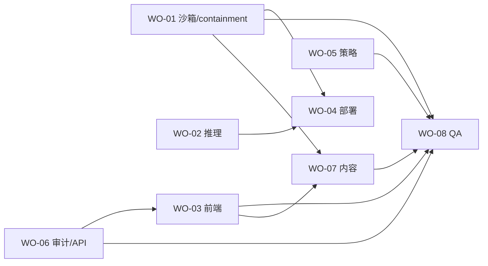

# 09 · 派单与并行开发计划

> 用途：把剩余开发拆成**互不冲突、可独立验收**的工单，直接派给执行者（人 / AI 编码代理）。
> 基线：骨架已就绪（策略引擎、trace、Agent 循环、Web/API、沙箱抽象，**72 个单测**通过，见 `08`）。
> 时间锚点：kickoff **11-03 23:00**（北京时间），提交截止 **11-09 06:00**。

---

## 1. 派单原则（先看这 5 条）

1. **写范围不重叠**：每张工单只改自己那组文件；跨界必须先在群里说一声。
2. **契约先行**：事件 schema（`docs/05` §9）、工具 schema（`backend/app/agent/tools.py`）、Controller API（`backend/app/controller.py`）在 kickoff 后冻结；要改先提，不要各改各的。
3. **验收必须可测**：每张卡都有"跑什么命令、看到什么结果"，不接受"我觉得好了"。
4. **先本地后云端**：赛前（11-03 前）只做零成本可验证的事；需要 Vultr 的动作全部排在 kickoff 后。
5. **不碰红线**：不部署未确认的收费资源、不改 YAI 主仓库、不接 Vultr 以外的 LLM。

---

## 2. 角色与工单总表

| 工单 | 名称 | 角色 | 估时 | 依赖 | 可开工时间 | 写文件范围 |
|---|---|---|---|---|---|---|
| **WO-00** | 集成 / 提交 / 节奏控制 | Lead（你） | 贯穿 | 全部 | 现在 | 全局协调，不改业务代码 |
| **WO-01** | 沙箱镜像 + 真实 containment + 宿主取证 | 沙箱/后端 | 6h | 无（本机 Docker 可用） | **现在** | `deploy/sandbox/`、`backend/app/sandbox/`、`backend/tests/test_docker_backend.py`、`docs/evidence/` |
| **WO-02** | 推理接入 + Planner 提示词 + tool-calling 收敛 | AI/后端 | 8h | WO-04（真实 key） | **现在写代码**，11-03 后验证 | `backend/app/agent/model_adapter.py`、`prompts.py`、`backend/tests/test_model_adapter.py` |
| **WO-03** | Web 时间线 / 审批 / trace 查看器 / 宿主完好面板 | 前端 | 10h | 无（用 mock 事件） | **现在** | `web/` |
| **WO-04** | Vultr 双 VM 开通、部署、TLS、防火墙 | 运维/部署 | 6h | WO-01 镜像、kickoff credits | 11-03 23:00 后 | `deploy/compose.*`、`deploy/Caddyfile`、`.env.example`、`docs/evidence/WO-04-*` |
| **WO-05** | 策略规则扩充 + 绕过语料 + 红队测试 | 安全 | 8h | 无 | **现在** | `backend/app/policy/`、`backend/tests/test_policy*.py`、`backend/tests/corpus/` |
| **WO-06** | 审计增强 + API 鉴权/限流/并发 + trace 校验端点 | 后端 | 8h | 无 | **现在** | `backend/app/trace/`、`backend/app/main.py`、`backend/tests/test_trace.py`、`test_api.py` |
| **WO-07** | README / slides / 视频脚本 / 提交文案 | 内容/产品 | 8h | WO-01/03 的截图与证据 | **现在写草稿** | `README.md`、`docs/submission/` |
| **WO-08** | 端到端 QA + 提交验收 | QA/Lead | 4h | 全部 | 11-05 后 | `scripts/verify_submission.py`、`docs/qa/` |

> 只有 7 张可并行开工的卡；WO-00 是你自己的集成位，不派出去。

### 2.1 当前状态板（2026-11-01 12:30 复核）

| 工单 | 状态 | 证据 / 说明 |
|---|---|---|
| WO-00 | 🟡 进行中 | 本轮完成复核、文档纠偏、真实 Docker E2E、提交前验收 |
| WO-01 | ✅ 完成 | 镜像 498MB；M1/M2/M3；真实 Docker 端到端 7 步/29 事件；[证据](evidence/WO-01-containment.md) |
| WO-02 | 🟡 代码完成 | 12 项离线测试通过；真实 key 的 Day-0 清单待 11-04 |
| WO-03 | ✅ 完成 | `web/app.js` + `styles.css`；时间线/审批/trace 校验/宿主面板；浏览器实测 |
| WO-04 | ⛔ 阻塞 | 等 11-03 kickoff 领 credits；compose/Caddy/firewall 文件已就绪；**本机已用双进程模拟 remote 路径通过** |
| WO-05 | ✅ 完成 | 68 条红队语料；新增 5 类规则；[证据](evidence/WO-05-policy.md) |
| WO-06 | ✅ 完成 | 72 项测试（含 8 项 API）；鉴权/限流/并发/trace 校验；[证据](evidence/WO-06-audit-api.md) |
| WO-07 | 🟡 素材完成 | README / slides / 视频脚本 / 提交文案；`YAI-Guard-slides.pptx`（12 页）+ `cover.png`（1920×1080）已生成；待录制视频 |
| WO-08 | 🟡 本地通过 | `verify_submission.py` 全 PASS（1 SKIP：视频未录）；云端/视频/提交待定 |

> **接手后的最短路径**：WO-04（11-03 夜）→ WO-02 真实推理 → 录视频 → 提交。其余功能一律冻结。

---

## 3. 依赖关系



**关键路径**：`WO-01 → WO-04 → 联调 → WO-08`。前端、策略、审计可以全程并行，不挡关键路径。

---

## 4. 两个波次

### 波次 1 · 赛前（现在 → 11-03 22:00，零成本）

| 工单 | 本轮必须交付 | 验收 |
|---|---|---|
| WO-01 | 沙箱镜像构建成功 + M1/M2/M3 在本机 Docker 跑通 + 宿主取证脚本 | `docker build` 成功；三个场景输出符合预期；证据文件落盘 |
| WO-02 | 真实适配层代码 + 模型白名单 + 防静默回落 + mock 单测 | 单测通过；无真实 key 也能测 |
| WO-03 | 新 UI 可跑：时间线、拦截高亮、审批、trace 下载、宿主面板 | `MOCK_MODEL=1 SANDBOX_DRIVER=fake` 下全流程可点 |
| WO-05 | 绕过语料 30+ 条 + 规则补齐 + 全绿 | `unittest` 全绿，核心演示命令不被误拦 |
| WO-06 | 审计字段补全 + 鉴权/限流/并发 + 校验端点 | 篡改检测、401/429、并发串行都可测 |
| WO-07 | README 骨架 + 5 分钟分镜 + slides 大纲 | 文档可读，claims 不越界 |

### 波次 2 · 活动期（11-03 23:00 → 11-09 06:00）

| 日期 | 动作 |
|---|---|
| 11-03 夜 | 领 credits → WO-04 起双 VM → WO-01 镜像上云 → WO-02 真实推理 Day-0 |
| 11-04 | 联调：app VM ↔ sandbox VM ↔ Vultr Inference；WO-03 接真实事件 |
| 11-05 | WO-05 红队复测；WO-06 审计/限流压测；WO-08 第一次全链路 |
| 11-06 | 冻结功能；WO-07 截图/录屏素材；WO-08 复现测试 |
| 11-07 | 录制 + README/slides 定稿；提交草稿 |
| 11-08 | 终审、提交（**11-09 03:00 前完成**） |

---

## 5. 写范围冲突矩阵

| 文件/目录 | WO-01 | WO-02 | WO-03 | WO-04 | WO-05 | WO-06 | WO-07 | WO-08 |
|---|---|---|---|---|---|---|---|---|
| `backend/app/sandbox/` | ✅ | | | | | | | |
| `backend/app/agent/` | | ✅ | | | | | | |
| `web/` | | | ✅ | | | | | |
| `deploy/sandbox/` | ✅ | | | | | | | |
| `deploy/compose.*`、`Caddyfile` | | | | ✅ | | | | |
| `backend/app/policy/` | | | | | ✅ | | | |
| `backend/app/trace/` | | | | | | ✅ | | |
| `backend/app/main.py` | | | | ⚠️只加环境变量 | | ✅ | | |
| `README.md` | | | | | | | ✅ | |
| `docs/`（新增内容） | `docs/evidence/` | | | `docs/evidence/` | | | `docs/submission/` | `docs/qa/` |

⚠️ `main.py` 归 WO-06；WO-04 只能改 `.env`/compose，不要动 Python。

---

## 6. 同步节奏（如果有多人）

- **每天 09:30 / 21:30 各一次 10 分钟同步**：昨天交付、今天唯一目标、卡点。
- **接口变更**：先在群里发"改什么/为什么/影响谁"，得到 Lead 确认再改。
- **阻塞升级**：卡住超过 1 小时，直接 @Lead，不要自己硬扛。
- **提交纪律**：每个工单一个小 PR 或一组 commit；PR 描述里贴验收命令与输出。
- **禁止**：多人同时改 `main.py`、同时改 `default_policy.json`、同时动 compose。

---

## 7. 派单话术模板（直接复制）

```
【工单】WO-xx <名称>
【仓库】E:\Competition\YAI Guard（git 仓库，main 分支）
【背景】YAI Guard 参加 Vultr Agent Rush / Challenge 1，骨架已完成（72 个单测）。
       读 docs/08-实现方案与骨架说明.md 了解现状。
【你的交付】见 dispatch/WO-xx-*.md 的"交付物"与"验收"两节。
【写文件范围】只允许改 dispatch/WO-xx-*.md 里列出的路径；其它文件一律不动。
【验收命令】dispatch/WO-xx-*.md 里逐条可复制。
【红线】不部署收费资源；不接 Vultr 以外 LLM；不改 YAI 主仓库；不弱化容器隔离参数。
【交付方式】commit + 贴验收输出；有问题先在群里问，不要猜。
```

---

## 8. 总验收（WO-08 用）

- [ ] `python -m unittest discover -s backend/tests -t backend` 全绿
- [ ] `python scripts/check_no_host_exec.py` 通过
- [ ] `python backend/demo_offline.py` 输出 hash-chain verify = True
- [ ] 真实 Docker：只读根 / 零网络 / 零 cap / fork bomb / CPU 限额 五项可复现
- [ ] 公网 HTTPS Demo 无痕可打开，提交一个任务能真实执行
- [ ] `rm -rf /` 被策略拒绝，UI 显示 rule + reason
- [ ] 宿主机指纹前后一致（可截图）
- [ ] trace.jsonl 可下载、`verify()` 通过
- [ ] README 从零可复现；LICENSE = MIT
- [ ] 视频 ≤5 分钟、≤300MB、含真实 containment moment
- [ ] lablab 表单全部字段填完并提交（11-09 03:00 前）

---

## 9. 工单文件索引

| 文件 | 内容 |
|---|---|
| [`dispatch/WO-01-沙箱镜像与containment.md`](../dispatch/WO-01-沙箱镜像与containment.md) | 镜像、M1/M2/M3、宿主取证、gVisor 探测 |
| [`dispatch/WO-02-推理接入与Planner.md`](../dispatch/WO-02-推理接入与Planner.md) | 真实适配层、白名单、防静默回落、收敛 |
| [`dispatch/WO-03-Web界面.md`](../dispatch/WO-03-Web界面.md) | 时间线、审批、trace、宿主面板 |
| [`dispatch/WO-04-Vultr部署.md`](../dispatch/WO-04-Vultr部署.md) | 双 VM、VPC、TLS、防火墙、冒烟 |
| [`dispatch/WO-05-策略与红队.md`](../dispatch/WO-05-策略与红队.md) | 绕过语料、规则、误拦控制 |
| [`dispatch/WO-06-审计与API加固.md`](../dispatch/WO-06-审计与API加固.md) | 审计字段、鉴权、限流、并发 |
| [`dispatch/WO-07-内容与提交物.md`](../dispatch/WO-07-内容与提交物.md) | README、slides、视频脚本 |
| [`dispatch/WO-08-验收与提交.md`](../dispatch/WO-08-验收与提交.md) | 端到端复现、提交清单 |
